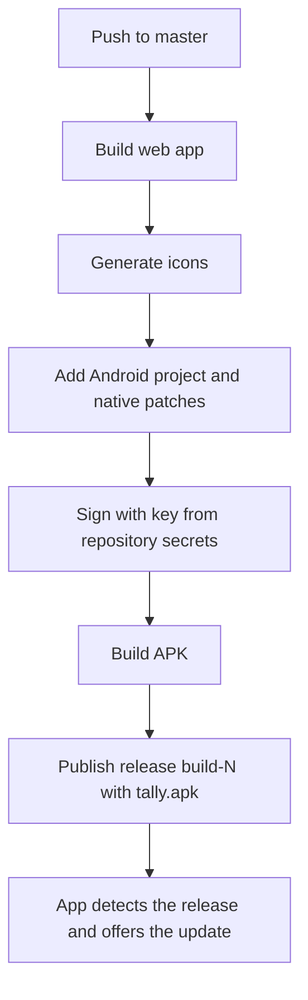

<div align="center">


<br />

[](https://github.com/byteghst/Tally-Exam-Tracker-V01-Upgraded-/releases/latest)
[](https://github.com/byteghst/Tally-Exam-Tracker-V01-Upgraded-/actions/workflows/android-build.yml)


**[Download for Android](https://github.com/byteghst/Tally-Exam-Tracker-V01-Upgraded-/releases/latest/download/tally.apk)** ·
[Features](#features) ·
[Design system](#design-system) ·
[Development](#development) ·
[Releases](#releases-and-updates)

</div>

---

## Overview

Tally is an exam, task and study tracker that synchronises across the web and Android clients.

All data is entered manually. Nothing is auto-graded, ranked or inferred. Derived views (Daily Mission, Momentum, Milestones, score extremes) are deterministic functions of the recorded data, with no AI involved.

---

## Features

| Area | Description |
|---|---|
| **Dashboard** | Next-exam card with a live countdown to the start time, data-driven greeting, Daily Mission, seven-day Momentum, today's tasks and study time. Widgets are hideable and reorderable; comfortable and compact densities. |
| **Exams** | Ledger filterable by daily, weekly and monthly. Create from a reusable config or manually, with a live score preview. The detail view compares against the previous exam of the same type. Upcoming exams display a live countdown. |
| **Exam configs** | Scoring templates defining negative marking and the MCQ and written structure per exam type. |
| **Tasks** | One-off and recurring (daily, weekdays, weekly, custom days) tasks with subtasks, priority, category, notes and reminders. |
| **Deadlines** | Due dates with an optional time, priority and a live countdown. Each deadline can be exported as a shareable card. |
| **Calendar** | Month grid with exam and task markers and a per-day agenda. |
| **Study** | Per-subject timers with custom colours and pictures. Elapsed time is derived from stored timestamps, so timing continues with the screen off or the app closed. |
| **Prayer times** | Daily prayer windows and prohibited times by Bangladeshi district (Islamic Foundation Bangladesh method), a prayer tracker with streak, and start, ending and prohibited-time reminders. |
| **Analytics** | Totals, averages and completion rate; exam score trend with highest and lowest results marked; task completion chart; milestones; downloadable monthly report; shareable score-trend image. |
| **Settings** | Theme (light, dark, system), dashboard layout and density, notification preferences, account and update controls. |
| **Reminders** | Native Android notifications that fire while the app is closed, with optional evening-before and morning briefings. |
| **Updates** | In-app detection of newer builds with one-step installation. |

**Data scope.** Exams, tasks, configs, deadlines, study subjects (with pictures) and sessions, and settings synchronise through Supabase. A running study timer exists on the device only until it is stopped and saved.

---

## Design system

A soft tonal system on warm paper. Surfaces are distinguished by fill, corner radius and a diffuse shadow; the interface uses no outlines or divider lines. Form fields are filled, not underlined. There is no blur or translucency, and no blue or purple in the palette.

### Palette

| Role | Light | Dark | |
|---|---|---|---|
| Surface | `#F0EADE` | `#100E0C` |   |
| Surface, raised | `#FDFBF7` | `#1F1C18` |   |
| Ink | `#1C1814` | `#F5EEE3` |   |
| **Persimmon** (primary accent) | `#D94F2D` | `#FF7A54` |   |
| Persimmon, soft | `#F9E3D8` | `#3E2118` |   |
| Forest (done, success) | `#2F7D5B` | `#5FC092` |   |
| Saffron (weekly, medium priority) | `#C98B12` | `#F2B84B` |   |
| Rose (lowest result) | `#C9486B` | `#F07496` |   |
| Crimson (destructive, high priority) | `#A82038` | `#FF6B7D` |   |

Colours, radii and shadow tones are CSS variables in `src/styles/globals.css`, exposed to Tailwind through `tailwind.config.ts`.

### Components

| Primitive | Behaviour |
|---|---|
| `GlassCard` | Raised, borderless panel with a soft shadow. The `accented` variant uses the soft accent fill. (The name is retained from an earlier design.) |
| `Section` | Titled block; `card` wraps the content in a raised panel. |
| `Input`, `Select`, `Textarea` | Filled fields with a focus ring in the accent colour. |
| `Segmented` | Tinted track with a sliding raised selection. |
| `Sheet` | Bottom sheet on mobile, dialog on desktop. |
| `LiveCountdown` | Inline or tiled countdown driven by a single shared one-second clock (`useNow`). |

### Typography

| Face | Use |
|---|---|
| Instrument Serif | Display type: greetings, countdowns, page and sheet titles |
| Fraunces | Secondary headings, subject names, share and report images |
| Plus Jakarta Sans | Interface and body text |
| Space Grotesk | Numerals: scores, timers, statistics |

Fonts are bundled through `@fontsource` and work offline. Tiro Bangla is the Bengali fallback in every stack.

### Motion

Framer Motion. Screens reveal sequentially, counters animate, and the active navigation pill slides between tabs. Only `transform` and `opacity` are animated. Reduced-motion system preferences are honoured.

### Identity

The logo, Android adaptive-icon layers and launch screen are generated from a single drawing by `scripts/build-icons.mjs` before each build. On Android the system bars follow the app's surface colour and invert for dark mode.

---

## Architecture

| Layer | Technology |
|---|---|
| UI | React 18, TypeScript, Vite |
| Styling | Tailwind CSS driven by CSS variables |
| Motion | Framer Motion |
| State | Zustand |
| Data and auth | Supabase (Postgres with Row Level Security, storage, email and password authentication, realtime) |
| Charts | Recharts |
| Validation | Zod |
| Native | Capacitor 6 (Android), local notifications |
| Web app | `vite-plugin-pwa` |
| Build tooling | `sharp` for icon generation |

### Repository layout

```text
src/
  pages/                 route-level screens
  components/
    ui/                  design-system primitives
    motion/              shared reveal and check animations
    layout/              app shell, bottom bar, sidebar, toasts
    features/            exams, tasks, deadlines, configs, calendar, analytics, update
    widgets/             dashboard blocks and the prayer popup
  store/                 Zustand stores
  lib/                   scoring, dates, countdown, momentum, milestones, prayer,
                         notifications, report and share-card rendering, update check
  hooks/                 theme, system bars, shared clock, notification sync
scripts/build-icons.mjs  icon and launch-screen generation
ci/force-signing.sh      native Android patches applied in CI
design/                  logo master and README banner
.github/workflows/       Android build and release pipeline
```

---

## Development

```bash
npm install
npm run dev                  # development server
npm run build                # generate icons, type-check, production build
npm run preview -- --host    # serve the production build
npm run test                 # run the test suite
npm run android:sync         # build and sync into the Capacitor Android project
```

### Environment

Copy `.env.example` to `.env`:

```bash
VITE_SUPABASE_URL=...
VITE_SUPABASE_ANON_KEY=...
```

The key is Supabase's publishable key and is intended to be public; data access is enforced by Row Level Security. A `service_role` key must never be placed in this file.

If email confirmation is enabled under **Authentication → Providers → Email**, new accounts must confirm their address before signing in.

---

## Releases and updates

Each push to `master` builds a signed Android APK and publishes it as a GitHub Release. The installed app compares its build number with the latest release and offers the update.



- **Latest APK:** `https://github.com/byteghst/Tally-Exam-Tracker-V01-Upgraded-/releases/latest/download/tally.apk`
- **Update check:** on launch and on return to the foreground, at most once every six hours. Settings provides a manual check. Updates install over the existing app and preserve data.
- **Versioning:** the Android `versionCode` and the `build-N` release tag are both derived from the workflow run number, so each build is strictly newer than the previous one.

### Signing

Android installs an update over an existing app only when both carry the same signing key. The key is not committed; it is held in repository secrets (Settings → Secrets and variables → Actions):

| Secret | Contents |
|---|---|
| `TALLY_KEYSTORE_B64` | Base64-encoded keystore |
| `TALLY_KEYSTORE_PASSWORD` | Keystore password |
| `TALLY_KEY_ALIAS` | Key alias |

Retain an offline backup of the keystore. If it is lost, installed copies can no longer be updated and must be reinstalled.

---

## Notifications

Reminders can be set on exams and tasks, with prayer reminders configured in the prayer popup. On Android these are scheduled as local notifications and are delivered while the app is closed. In a browser, notifications fire only while the tab or installed web app is open; this is a platform limitation.
