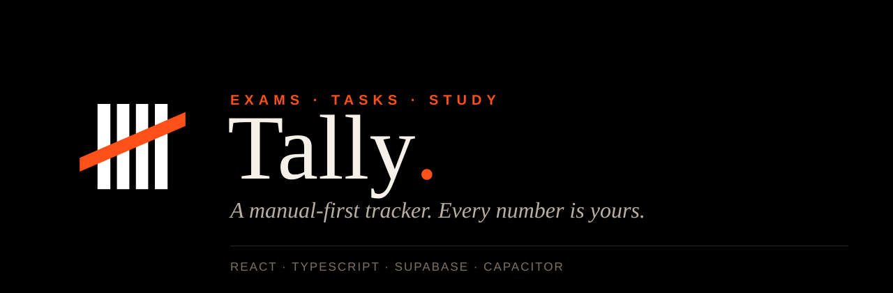
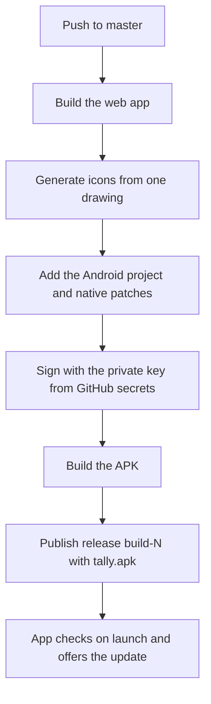

<div align="center">



<br />

[](https://github.com/byteghst/Tally-Exam-Tracker-V01-Upgraded-/releases/latest)
[](https://github.com/byteghst/Tally-Exam-Tracker-V01-Upgraded-/actions/workflows/android-build.yml)


**[Download the Android app](https://github.com/byteghst/Tally-Exam-Tracker-V01-Upgraded-/releases/latest/download/tally.apk)** ·
[Features](#-features) ·
[Design](#-design) ·
[Getting started](#-getting-started) ·
[How releases work](#-releases-and-in-app-updates)

</div>

---

## ✦ What Tally is

Tally is a personal exam, task and study tracker, synced across every device you sign in on (web and the Android app).

It is **manual-first**. Nothing is auto-graded, auto-ranked or guessed: every exam result and task is entered by hand. Every "smart" touch (Daily Mission, Momentum, Milestones, the highest and lowest marks on your chart) is a plain, deterministic function over that same real data. No AI, no invented stats.

---

## ✦ Features

| | |
|---|---|
| **Dashboard** | A big next-exam countdown, a data-driven greeting, a dismissible Daily Mission, a 7-day Momentum strip, today's tasks and today's study time. Widgets can be hidden and reordered, with comfortable or compact density. |
| **Exams** | A ledger of every exam with filters for daily, weekly and monthly. Add one against a reusable config (the structure fills itself) or fully by hand. A live score appears as you type. The detail page compares against the previous exam of the same type. Edit, duplicate, delete. |
| **Exam configs** | Reusable scoring templates for a course: negative marking, plus MCQ and written breakdown per exam type. Set it once, then just pick it. |
| **Tasks** | One-off or repeating (daily, weekdays, weekly, custom days), with priority, category, notes and reminders. Ticks and strike-throughs animate as you finish things. |
| **Calendar** | Month grid with exam and task markers and a day agenda underneath. |
| **Study** | A subject timer with colours and pictures. It keeps counting with the screen off or the app closed (it stores timestamps, not a ticking counter). |
| **Analytics** | Totals, average and completion rate; an exam score trend with your **highest and lowest** results marked; a task completion chart; milestones; a downloadable monthly report; and a shareable score-trend image. |
| **Settings** | Theme (light, dark, system), dashboard layout and density, reminder switches, account, and app updates. |
| **Reminders** | Real Android notifications that fire even when the app is closed, plus an optional evening-before heads-up and a morning briefing. |
| **Updates** | The app checks for a newer build and offers it in one tap (see [Releases and in-app updates](#-releases-and-in-app-updates)). |

> **Good to know**
> - Study subjects and sessions are kept **on the device** (not synced). Exams, tasks, configs and settings sync through Supabase.
> - Rank is not shown anywhere. The app no longer asks for it, and any rank saved on older exams is simply ignored.

---

## ✦ Design

Editorial and flat: warm paper and ink, big serif numbers, hairline rules, and motion that does the talking. There is **no glass, no blur, no shadows, no search bar**, and **no blue or purple anywhere**.

### Palette

| Role | Light | Dark | |
|---|---|---|---|
| Paper | `#F6F1E8` | `#12100E` |   |
| Ink | `#1C1814` | `#F5EEE3` |   |
| **Persimmon** (main accent) | `#D94F2D` | `#FF7A54` |   |
| Forest (done, best, success) | `#2F7D5B` | `#5FC092` |   |
| Saffron (weekly, medium) | `#C98B12` | `#F2B84B` |   |
| Rose (lowest result) | `#C9486B` | `#F07496` |   |
| Crimson (destructive, high priority) | `#A82038` | `#FF6B7D` |   |

All colours live as CSS variables in `src/styles/globals.css` and are exposed to Tailwind in `tailwind.config.ts`, so changing a colour is a one-line edit.

### Type

| Face | Used for |
|---|---|
| Instrument Serif | Big editorial type: greetings, countdowns, page and sheet titles, confirmation messages |
| Fraunces | Smaller headings, subject names, and the share and report images |
| Plus Jakarta Sans | Interface and body text |
| Space Grotesk | Numerals: scores, timers, stats |

Fonts are bundled with `@fontsource`, so they work offline.

### Motion

Built with Framer Motion. Screens reveal block by block, hairlines draw themselves in, numbers count up, ticks draw and strikes sweep across, tabs and filters slide an underline, and sheets rise with a long ease-out. Only `transform` and `opacity` are animated (never blur or filters) to stay smooth on mid-range phones, and everything respects the phone's "remove animations" setting.

### The logo and system bars

The logo is four white bars with one orange stroke on black. Every icon, the Android adaptive-icon layers and the launch screen are generated from a single drawing (`scripts/build-icons.mjs`) before each build, so they can never drift apart. On Android, the status bar and navigation bar take the app's paper colour, with icons that flip for dark mode.

---

## ✦ Tech stack

| Layer | Choice |
|---|---|
| UI | React 18, TypeScript, Vite |
| Styling | Tailwind CSS driven by CSS variables |
| Motion | Framer Motion |
| State | Zustand |
| Data and auth | Supabase (Postgres with Row Level Security, email and password auth, realtime) |
| Charts | Recharts |
| Validation | Zod |
| Native | Capacitor 6 (Android), local notifications |
| Web app | `vite-plugin-pwa` |
| Images | `sharp`, for generating icons at build time |

### Project layout

```text
src/
  pages/               one file per screen (Dashboard, Exams, Tasks, Study, ...)
  components/
    ui/                buttons, fields, sheets, switches, progress, logo
    motion/            reveal and check animations shared across screens
    layout/            app shell, bottom bar, sidebar, toasts
    features/          exam, task, config, calendar, analytics, update ...
    widgets/           dashboard blocks
  store/               Zustand stores (exams, tasks, configs, settings, study, ui)
  lib/                 scoring, dates, momentum, milestones, motion, palette,
                       notifications, report and share-card drawing, update check
  hooks/               theme, system bars, notification sync, ...
scripts/build-icons.mjs  generates every icon and the launch screen
ci/force-signing.sh      native Android patches used by the build
design/                  logo master and README banner
.github/workflows/       Android build and release pipeline
```

---

## ✦ Getting started

```bash
npm install
npm run dev                  # dev server
npm run build                # generate icons, type-check, production build
npm run preview -- --host    # serve the production build locally
npm run test                 # run the test suite once
npm run android:sync         # build and sync into the Capacitor Android project
```

### Environment

Copy `.env.example` to `.env`:

```bash
VITE_SUPABASE_URL=...
VITE_SUPABASE_ANON_KEY=...
```

The key is Supabase's **publishable** key, which is designed to be public. Row Level Security is what protects the data (each row is only visible to the account that created it). Never put a `service_role` key in this file.

> In the Supabase dashboard, check **Authentication → Providers → Email**. If email confirmation is on, new accounts must click the confirmation link before they can sign in. For a personal app you may want it off.

---

## ✦ Releases and in-app updates

Every push to `master` builds a signed Android APK and publishes it as a GitHub Release. The installed app compares its own build number with the newest release and offers the update.



- **Always the newest APK:** `https://github.com/byteghst/Tally-Exam-Tracker-V01-Upgraded-/releases/latest/download/tally.apk`
- **In the app:** it checks on launch and when you return to it (at most every 6 hours), shows an "Update available" sheet, and Settings has a manual **Check for updates**. The update installs over the old app and keeps your data.
- **Versioning:** the Android `versionCode` and the `build-N` release tag both come from the workflow run number, so each build is strictly newer than the last.

### Signing key

Android only installs an update over an existing app if both are signed with the **same key**. The key is private and is never committed. It lives in three repository secrets (Settings → Secrets and variables → Actions):

| Secret | What it holds |
|---|---|
| `TALLY_KEYSTORE_B64` | the keystore file, base64-encoded |
| `TALLY_KEYSTORE_PASSWORD` | its password |
| `TALLY_KEY_ALIAS` | the key alias |

> Keep a backup of the keystore somewhere safe. If it is lost, installed apps can no longer be updated and would have to be uninstalled and reinstalled.

---

## ✦ Notifications

Set a reminder (minutes before) on any exam or task. On the native Android app this schedules real OS-level local notifications that fire even if the app is closed. In a browser, notifications can only fire while the tab or installed web app is open. That is a hard platform limit, not a bug here.

---

## ✦ A short history

- **Supabase replaced local storage.** Exams, tasks, configs and settings sync in real time across devices behind Row Level Security.
- **Exam configs** replaced hand-entering the structure every time; Syllabus, Deadlines and History were removed.
- **The redesign.** Flat, editorial, warm palette, cinematic motion, new navigation (a bottom bar with an upward-expanding More menu), editorial forms, and no search bar.
- **Releases and updates.** GitHub Releases plus an in-app update check, signed with a private key stored in secrets.
- **Polish.** The original four-bar logo restored and made larger and sharper; system bars that blend into the app; confirmation messages in the app's own voice.
